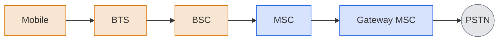
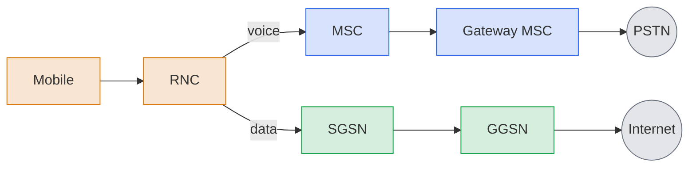
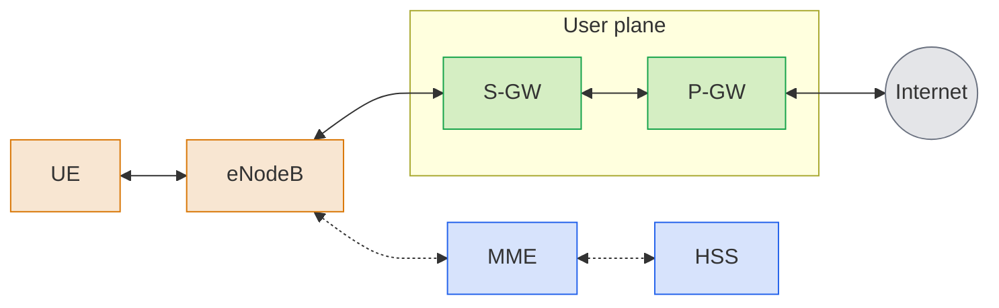
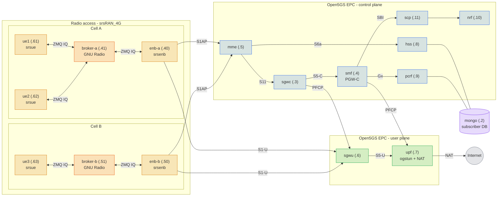
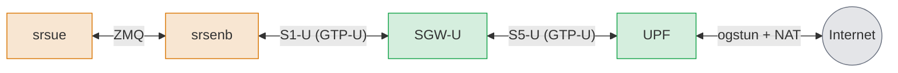

During the Advanced Networking course of my master we covered the architecture of cellular networks, from 2G all the way to 5G. Aside from some studying, to prepare for the upcoming exam I decided to build my own local telecom that runs entirely in Docker on a single machine, built from open-source components. There is no radio hardware and no over-the-air transmission, as you need expensive hardware and permissions. The "radio" is therefore a virtual link that carries IQ samples over TCP, and the "phones" are software UEs (just Docker containers).

This first part of the series covers some of the theory, and then walks through the 4G stack: the architecture, the SIM and authentication, and how to run the infrastructure yourself. All of the sourcecode and the more detailed documentation can be found here: **[github.com/Tonemon/telecom-poc](https://github.com/Tonemon/telecom-poc)**.


## A bit of telecom theory first

Before diving into containers it helps to know where 4G comes from, because a lot of its design choices are reactions to the generations before it. Almost every generation brought a ~10× increase in data rate, but each generation also had a different focus on functionality:

| Generation | Era | Key Technology | Max Data Rate | Focus |
|---|---|---|---|---|
| **1G** | 1980s | AMPS, NMT, TACS | ~10 kbps | Analog voice |
| **2G** | 1990s | GSM, D-AMPS, IS-95 (CDMA) | ~100 kbps | Digital voice |
| **3G** | 2000s | WCDMA/HSPA+, CDMA2000 | ~10 Mbps | Mobile data |
| **4G** | 2010s | LTE, LTE-Advanced | ~1 Gbps | Mobile broadband |
| **5G** | 2020s | 5G NR (New Radio) | ~10 Gbps | Unified connectivity fabric |

The basic idea has always been the same where the network is divided into **cells**, each served by a **base station** (comparable to a WiFi access point), and mobile devices attach to that base station over the **air interface**. Behind the base stations sits the operator's core network, which decides who is allowed on the network, keeps track of where every device is and connects them to the outside world.


### From circuits to packets

**2G** was built for voice and is **circuit-switched**. When you make a call, a dedicated path is reserved end-to-end for the duration of the call. The Base Transceiver Station (BTS) is the radio hardware at the tower, the Base Station Controller (BSC) manages the radio resources and handovers, and the Mobile Switching Center (MSC) does pretty much everything else: call setup, routing, authentication and tracking where you are. The full path looks like the following:




**3G** added mobile data where a parallel packet-switched data network was added onto the existing voice network infrastructure:



The difference between those two worlds is the core of the whole story:

|  | Circuit Switching | Packet Switching |
|---|---|---|
| **Resources** | Dedicated path reserved before any data flows | Shared on-demand, no reservation |
| **Bandwidth** | Fixed allocation, idle capacity is wasted | Statistical multiplexing |
| **Failures** | Path breaks → call drops | Packets are rerouted |
| **QoS** | Guaranteed by the reservation | Best-effort, QoS mechanisms added on top |
| **Example** | PSTN, ISDN | Internet, LTE EPC, 5G |


### Everything becomes IP

With **4G LTE** (Long Term Evolution), the core network **Evolved Packet Core (EPC)**, is all IP-based. There is no MSC anymore, and voice in this scenario is just another IP application (VoLTE). Together with the radio access network (E-UTRAN) this forms the **Evolved Packet System (EPS)**.

In a lot of ways a 4G network looks like the wired internet. It uses IP, TCP, UDP, DNS and NAT, has an edge/core distinction and makes heavy use of tunneling. What makes it different is that **mobility is a first-class service**, user identity is tied to a **SIM card** (the IMSI) instead of an address, and there is a strong concept of a **home network** versus roaming on a visited network, with authentication infrastructure and settlements between carriers.

The most important design decision for this project however is the strict **separation of the control plane and the user plane**. Signaling (who are you, where are you, set up a session) travels over completely different paths and components than the actual user data. That separation is visible in the containers mentioned later on.


## 4G and the building blocks

A minimal 4G network consists of six components. In the diagram below, the green gateways carry the data you send and receive, while the blue components handle the signaling that sets that path up:



| Component | Full Name | What it does |
|---|---|---|
| **UE** | User Equipment | The phone. Holds a SIM with the subscriber's identity (IMSI) and secret key. |
| **eNodeB** | Evolved Node B | The base station. Manages radio resources for all devices in its cell and coordinates handovers with neighbouring eNodeBs over X2. |
| **MME** | Mobility Management Entity | The control-plane brain. Authenticates devices together with the HSS, sets up the tunnels for user data and tracks where idle devices are. No user data ever flows through it. |
| **HSS** | Home Subscriber Server | The subscriber database of the home network, the 4G equivalent of the 2G HLR. Holds the keys the MME needs to authenticate a device. |
| **S-GW** | Serving Gateway | The data-plane anchor that tunnels traffic between the eNodeB and the P-GW. |
| **P-GW** | PDN Gateway | The exit to the internet. Allocates the device's IP address and NATs its traffic. |

These components talk to each other over standardized interfaces, each with a name that will be visible in configs and logs all the time:

| Interface | Between | Purpose |
|---|---|---|
| **S1-MME** | eNodeB ↔ MME | Control signaling (S1AP over SCTP), carries the NAS messages from the UE. |
| **S1-U** | eNodeB ↔ S-GW | User-plane data (GTP-U). |
| **S11** | MME ↔ S-GW | Session and bearer management (GTP-C). |
| **S5/S8** | S-GW ↔ P-GW | Control + user plane. S5 within one operator, S8 when roaming. |
| **S6a** | MME ↔ HSS | Authentication and subscriber data (Diameter). |
| **SGi** | P-GW ↔ Internet | The edge towards the public internet. |
| **X2** | eNodeB ↔ eNodeB | Handover coordination, bypassing the core entirely. |


### Tunnels all the way down

On the user plane, a datagram from your phone doesn't get routed hop by hop through the operator's network. Instead it gets wrapped in the **GPRS Tunneling Protocol (GTP)** inside UDP, sent from the eNodeB to the S-GW, which then re-tunnels it to the P-GW. Only the P-GW unwraps it and sends it out onto the internet.

This seems like a lot of overhead, but it's the trick that makes mobility work. Your IP address is allocated by the P-GW and stays the same, no matter which base station you are connected to. When you move to another cell, only the *tunnel endpoint* (identified by a Tunnel Endpoint Identifier, TEID) between the S-GW and the eNodeB changes. That is what's called the **path switch procedure**, and it's why your video call doesn't drop when you are on a train.

The data travels through a so-called **EPS bearer**, a logical pipe between the UE and the P-GW with its own QoS parameters. Every device gets a **default bearer** when it attaches, which is always best-effort (non-GBR) with **QCI 9**, the lowest priority with a 300 ms delay budget. Services that need guarantees, like voice, get an additional *dedicated* bearer with a guaranteed bit rate.


### Signaling: RRC and NAS

On the control plane there are two layers of signaling to keep apart:

- **Radio Resource Control (RRC)**, between the UE and the eNodeB. It handles connection establishment and release, broadcasts system information and handles paging.
- **Non-Access Stratum (NAS)**, between the UE and the MME. The eNodeB just relays these messages transparently. NAS consists of **EMM** (mobility management: attach, detach, tracking area updates) and **ESM** (session management: setting up and tearing down bearers).

Putting it together, an **initial attach** would look something like this: the eNodeB continuously broadcasts synchronization signals, the UE finds them, reads the cell's system information (including which operator it belongs to), sets up an RRC connection and sends a NAS *Attach Request* to the MME. The MME asks the HSS for authentication material, both sides prove to each other who they are, security is switched on, and the MME tells the gateways to create the default bearer. The UE receives an IP address and it's online. That whole sequence is what I want to be able to observe in the telecom-poc network.


### From theory to containers

The network is built from two open-source projects that are compiled from source into local Docker images (see [`deploy/images/`](https://github.com/Tonemon/telecom-poc/tree/main/deploy/images)):

- **[Open5GS](https://github.com/open5gs/open5gs)** provides the mobile core, every network function of the EPC.
- **[srsRAN_4G](https://github.com/srsran/srsRAN_4G)** provides the radio access side, a software eNodeB (`srsenb`) and a software UE (`srsue`) as we cannot use real radios.

A single **MongoDB** instance stores the subscriber records, which is the SIM database of the operator. Everything runs on one Docker bridge network, `172.22.0.0/24`, with **static IPs** for every container. Diameter, GTP and PFCP peers are configured by address, so having deterministic IPs saves a lot of headaches. The full topology consists of two cells with three phones between them:



Blue is the control plane (signaling path), green the user plane (the path that the data from the UEs actually takes), orange the simulated radio access network, and the GNU Radio brokers sit on the virtual radio link between each eNodeB and its phones. All three phones share the same core network. This network also has 3 UEs so we can see the UEs per cell, but also perform a test later on where we switch a UE between two cells, simulating for example physical travel.

A few things stand out when you compare this diagram to the 4G diagram from earlier.


#### The gateways are split in two

Data traffic grows much faster than signaling, and operators want to place the gateways that forward packets close to their users while keeping the session logic in one central place. To make that possible, later 3GPP releases introduced **CUPS** (Control and User Plane Separation), which splits *every gateway* into a control half and a user half that can be scaled and deployed independently. That's why there are four containers instead of a single S-GW and P-GW:

- **`sgwc` + `sgwu`** (Serving Gateway). The `sgwc` handles session setup between the MME (S11) and the SMF (S5-C) and programs the `sgwu` over **PFCP**. The `sgwu` only forwards GTP-U traffic between the eNodeB and the UPF.
- **`smf` + `upf`** (PDN Gateway, using their 5G names because Open5GS shares them with its 5G core). The `smf` allocates the UE's IP from `10.45.0.0/16`, creates the default bearer and gets the QoS policy from the `pcrf` over **Gx/Diameter**. The `upf` is the exit to the internet: it decapsulates the GTP-U traffic onto an `ogstun` TUN device and NATs it out with `iptables MASQUERADE`.

Reusing the 5G functions has one odd side effect: the SMF won't start cleanly without the **`nrf`** (5G service discovery) and the **`scp`** (the proxy it registers through), so a small piece of the 5G Service-Based Architecture sneaks into this currently 4G-only stack.

The other control-plane functions map one-to-one onto the theory. The **`mme`** terminates S1AP from the eNodeBs, runs the NAS attach procedure and fetches authentication vectors from the **`hss`** over S6a, which in turn reads the subscriber records from **`mongo`**. All of their configs can be found in [`deploy/4g/config/`](https://github.com/Tonemon/telecom-poc/tree/main/deploy/4g/config) and the services themselves in [`docker-compose.yml`](https://github.com/Tonemon/telecom-poc/blob/main/deploy/4g/docker-compose.yml).


#### A radio without radio waves

The part that makes this project possible without any hardware (or a radio license) is srsRAN's **ZeroMQ (ZMQ) driver**. Normally srsenb and srsue would hand their baseband IQ samples to a software-defined radio like a USRP, which turns them into actual radio waves. With the ZMQ driver those samples are instead streamed over a TCP socket to the other side, which processes them as if they came from an antenna. Everything above the physical layer (MAC, RLC, PDCP, RRC and NAS) is the real LTE stack.

The catch is that a ZMQ link is **point-to-point**. One eNodeB talks to exactly one UE, which is fine for a first test but not very realistic for a telecom. To get several phones into one cell, each cell has a small **GNU Radio broker** ([`deploy/4g/broker/broker.py`](https://github.com/Tonemon/telecom-poc/blob/main/deploy/4g/broker/broker.py)) sitting between the eNodeB and its UEs. It sums the uplink IQ samples of all UEs into the single receive stream of the eNodeB, and fans the eNodeB's downlink out to every UE, which is basically what the air does for free in the real world. Every RF endpoint runs at the same sample rate of **23.04 MS/s**, and the order matters: a broker has to start *after* its eNodeB and UEs. Getting this broker to work took some time and you can read about it in [`docs/parts/2-multi-ue-broker.md`](https://github.com/Tonemon/telecom-poc/blob/main/docs/parts/2-multi-ue-broker.md).


#### Simulated UEs and Docker

As we are simulating devices with SIM capabilities using Docker containers, each UE container gets an interface, `eth0`, which only exists to carry the simulated ZMQ radio link over the Docker network. But Docker also gives every container internet access through its own NAT, completely independent of the cellular network. So a UE could reach the internet *without* being attached at all, which is of course not realistic.

The fix is in [`ue-entrypoint.sh`](https://github.com/Tonemon/telecom-poc/blob/main/deploy/4g/scripts/ue-entrypoint.sh), where `eth0` is locked down with iptables so it can only reach the `epc` subnet (the radio link keeps working, nothing else can leave through it), and the default route points to `tun_srsue`, which is the interface that srsue creates when the attach succeeds. The result is that a UE's internet access depends entirely on its cellular attach state, just like a real phone that has no data at all when it isn't connected to the network.


## The SIM and authentication

In 4G, the network and the phone authenticate *each other*. The network wants to know you are a paying subscriber, but you also want to know that you are not talking to a fake base station. This is done with the **AKA** (Authentication and Key Agreement) procedure, which relies on a secret key that is stored in exactly two places: the SIM card and the operator's HSS. It is never sent over the air.

This means that a subscriber is defined by a set of values that must match on **both** sides:

| Value | What it is | Core side | UE side |
|---|---|---|---|
| **IMSI** `999700000000001` | The subscriber's globally unique identity. | `mongo` subscriber document | `[usim] imsi` |
| **Ki** `465B5CE8...A6BC` | The secret authentication key, never transmitted. | `mongo` subscriber document | `[usim] k` |
| **OPc** `E8ED289D...83CA` | Operator-specific key material, combined with Ki to derive the session keys. | `mongo` subscriber document | `[usim] opc` |
| **PLMN** `MCC 999 / MNC 70` | The operator identity, a country and network code. | [`mme.yaml`](https://github.com/Tonemon/telecom-poc/blob/main/deploy/4g/config/mme.yaml) | IMSI prefix + eNodeB `mcc`/`mnc` |
| **APN** `internet` | The packet data network the UE wants to connect to. | subscriber document + [`smf.yaml`](https://github.com/Tonemon/telecom-poc/blob/main/deploy/4g/config/smf.yaml) | `[nas] apn` |

The PLMN `999/70` was chosen as the mobile country code 999 is reserved for private and test networks, so there is no chance of colliding with a real operator. The IMSI starts with that same `99970` prefix, which is how a phone (and a visited network) knows which home network it belongs to.

On the UE side there's no plastic card involved. In srsue the SIM is a **soft USIM**, a block in the UE's config file. That means the `[usim]` section of [`ue1.conf`](https://github.com/Tonemon/telecom-poc/blob/main/deploy/4g/config/multi/ue1.conf) literally *is* the eSIM profile of the first phone:

```ini
[usim]
mode = soft
algo = milenage
opc  = E8ED289DEBA952E4283B54E88E6183CA
k    = 465B5CE8B199B49FAA5F0A2EE238A6BC
imsi = 999700000000001
imei = 353490069873319
```

When the UE sends its Attach Request, the MME asks the HSS for an **authentication vector**. The HSS generates a random challenge (`RAND`) and uses the Ki and OPc to compute the expected response (`XRES`), an authentication token (`AUTN`) and the key material for the session. The MME forwards `RAND` and `AUTN` to the UE. The SIM checks `AUTN` to verify that the challenge really came from its home network, computes its own response `RES` and sends that back. If `RES` matches `XRES`, both sides have proven they know the same secret without ever sending it, and they derive the same keys to encrypt and integrity-protect everything that follows.

The functions that do these computations are defined by the **Milenage** algorithm set, built on AES-128. It's also the only real algorithm that both Open5GS and srsue support (srsue also supports `xor`, but that's an insecure test dummy). In the beginning I added subscribers with a small wrapper around Open5GS's own `open5gs-dbctl` tool ([`add-subscriber.sh`](https://github.com/Tonemon/telecom-poc/blob/main/deploy/4g/scripts/add-subscriber.sh)), but a real operator never lets an employee write directly into the subscriber database. So the stack now contains its own provisioning service written in Go, with a client called [`telcoctl`](https://github.com/Tonemon/telecom-poc/tree/main/tools/provisioner/cmd/telcoctl). Maybe later I'll add a web interface portal to do the subscriber management in a more realistic way.

If the Ki or OPc disagree between the two sides, the attach fails at authentication. If the PLMN or tracking area code disagree between the eNodeB and the MME, it fails even earlier, as the MME will reject the eNodeB before any phone can try to attach.


## Running the infra

For the testing environment I ran the whole project in a 4 CPU, 8GB RAM, and 32GB HDD VM running Ubuntu Server 24.04. The only software requirements to run the whole stack are [Docker with Compose](https://docs.docker.com/engine/install/ubuntu/#install-using-the-repository) and `make`. The upstream projects are included as git submodules, so those need to be fetched first:

```bash
git clone https://github.com/Tonemon/telecom-poc.git
cd telecom-poc/
make submodules
```

The first build compiles Open5GS and srsRAN from source, which can take some time.


### The one-shot way

The [`Makefile`](https://github.com/Tonemon/telecom-poc/blob/main/Makefile) has a single target that does everything in an automated way from a clean state: build the images, start the full two-cell/three-UE topology, provision the three subscribers, wait for every UE to attach and ping `8.8.8.8` from each of them through the UPF. The `make 4g-auto` command below **will take a long time** as it has to build the required broker/provisioner containers first, deploy them, and then build the `telecom-poc/srsran:local` image for the eNBs and UEs.

```bash
make 4g-auto        # build, start, provision, attach and ping
make status-4g      # check the health of all services
make 4g-auto-down   # tear it all down again (including the mongo volume)
```

A successful run shows the provisioned subscribers, the starting of the eNBs and UEs, and ends with the phones pinging the internet through their cellular tunnel:

```output
...
==> [2/4] Provisioning the 3 fixed subscribers...
./deploy/4g/scripts/provision-multi.sh
Waiting for provisioner...
{
  "imsi": "999700000000001",
  "k": "465B5CE8B199B49FAA5F0A2EE238A6BC",
  "opc": "E8ED289DEBA952E4283B54E88E6183CA",
  "usim_block": "[usim]\nmode = soft\nalgo = milenage\nopc  = E8ED289DEBA952E4283B54E88E6183CA\nk    = 465B5CE8B199B49FAA5F0A2EE238A6BC\nimsi = 999700000000001\nimei = 353490069873319\n"
}
{
  "imsi": "999700000000002",
  "k": "00112233445566778899AABBCCDDEEFF",
  "opc": "000102030405060708090A0B0C0D0E0F",
  "usim_block": "[usim]\nmode = soft\nalgo = milenage\nopc  = 000102030405060708090A0B0C0D0E0F\nk    = 00112233445566778899AABBCCDDEEFF\nimsi = 999700000000002\nimei = 353490069873319\n"
}
{
  "imsi": "999700000000003",
  "k": "8899AABBCCDDEEFF0011223344556677",
  "opc": "0F0E0D0C0B0A09080706050403020100",
  "usim_block": "[usim]\nmode = soft\nalgo = milenage\nopc  = 0F0E0D0C0B0A09080706050403020100\nk    = 8899AABBCCDDEEFF0011223344556677\nimsi = 999700000000003\nimei = 353490069873319\n"
}
Multi-UE subscribers provisioned.

==> [3/4] Starting eNBs (enb-a, enb-b) and UEs (ue1, ue2, ue3)...
...
 ✔ Container telecom-poc-4g-enb-a-1      Started                                   4.8s
 ✔ Container telecom-poc-4g-enb-b-1      Started                                   6.0s
 ✔ Container telecom-poc-4g-ue1-1        Started                                   6.6s
 ✔ Container telecom-poc-4g-ue2-1        Started                                   5.1s
 ✔ Container telecom-poc-4g-ue3-1        Started                                   7.8s
...

==> [4/4] Starting brokers LAST (broker-a, broker-b)...
...
UE attached:  inet 10.45.0.2/24 scope global tun_srsue
PING 8.8.8.8 (8.8.8.8) from 10.45.0.2 tun_srsue: 56(84) bytes of data.
64 bytes from 8.8.8.8: icmp_seq=1 ttl=126 time=66.9 ms
64 bytes from 8.8.8.8: icmp_seq=2 ttl=126 time=32.4 ms
64 bytes from 8.8.8.8: icmp_seq=3 ttl=126 time=45.5 ms
64 bytes from 8.8.8.8: icmp_seq=4 ttl=126 time=52.0 ms

--- 8.8.8.8 ping statistics ---
4 packets transmitted, 4 received, 0% packet loss, time 3002ms
```

To stop the one-shot deployment we can simply use the command `make 4g-auto-down`, which stops and removes all containers (but will leave the docker images).


### The operator way

The one-shot target is great for testing the whole flow, but it does not allow you to experiment with the individual components. A real operator's network exists long before any SIM card is sold, so the deployment can also be done in stages using the following commands:

```bash
make 4g-infra             # the operator network: EPC core + both eNodeBs, no subscribers, no UEs
# Network is ready: full EPC core + both eNBs are up. No subscribers provisioned yet.

# Next — provision the 3 fixed demo subscribers:
#     make 4g-demo-subscribers
# Then bring up device(s):
#     make 4g-device         # one device (ue1)
#     make 4g-demo-devices   # all three devices

# Or drive the operator API by hand from your host: 'make telcoctl', then e.g.:
#     TELCOCTL_SERVER=http://127.0.0.1:8080 TELCOCTL_TOKEN=dev-operator-token ./bin/telcoctl list


make 4g-demo-subscribers  # provision the 3 demo subscribers via telcoctl
make 4g-device            # bring up ONE phone: ue1 → subscriber …001 → enb-a, attach + ping
make 4g-demo-devices      # or bring up all three phones (and their brokers)
```

`make 4g-infra` does not provision anything, it creates and starts the network and then prints how to use the `telcoctl` client. Only after the subscribers exist does it make sense to switch on a phone.

To stop this complete deployment we can again use the `make 4g-auto-down` command.


### Deploying manually step by step

To really see what's going on between the components, everything can also be brought up by hand as well. You first start the core:
```bash
docker compose -f deploy/4g/docker-compose.yml up -d mongo provisioner nrf scp hss pcrf sgwc sgwu upf smf mme
docker compose -f deploy/4g/docker-compose.yml ps
```

Before any radio is involved, the core functions find each other over their own interfaces. Each of those links can be confirmed in the logs:

```bash
## Diameter: S6a (MME ↔ HSS) and Gx (SMF ↔ PCRF), expect four "CONNECTED TO" lines
docker compose -f deploy/4g/docker-compose.yml logs mme hss smf pcrf | grep "CONNECTED TO"
# pcrf-1 | 10/29 17:35:22.038: [diam] INFO: CONNECTED TO 'smf.localdomain' (SCTP,soc#7): (../lib/diameter/common/logger.c:81)
# mme-1  | 10/29 17:35:26.363: [diam] INFO: CONNECTED TO 'hss.localdomain' (SCTP,soc#15): (../lib/diameter/common/logger.c:81)
# smf-1  | 10/29 17:35:22.042: [diam] INFO: CONNECTED TO 'pcrf.localdomain' (SCTP,soc#18): (../lib/diameter/common/logger.c:81)
# hss-1  | 10/29 17:35:26.362: [diam] INFO: CONNECTED TO 'mme.localdomain' (SCTP,soc#7): (../lib/diameter/common/logger.c:81)


## PFCP: the control halves programming the user halves (.3 ↔ .6 and .4 ↔ .7)
docker compose -f deploy/4g/docker-compose.yml logs | grep "PFCP associated"
# upf-1  | 10/29 17:35:22.028: [upf] INFO: PFCP associated [172.22.0.4]:8805 (../src/upf/pfcp-sm.c:168)
# sgwu-1 | 10/29 17:35:14.860: [sgwu] INFO: PFCP associated [172.22.0.3]:8805 (../src/sgwu/pfcp-sm.c:163)
# sgwc-1 | 10/29 17:35:14.861: [sgwc] INFO: PFCP associated [172.22.0.6]:8805 (../src/sgwc/pfcp-sm.c:167)
# smf-1  | 10/29 17:35:22.035: [smf] INFO: PFCP associated [172.22.0.7]:8805 (../src/smf/pfcp-sm.c:189)

## SBI: the SMF registering with the NRF through the SCP
docker compose -f deploy/4g/docker-compose.yml logs smf | grep "NF registered"
# smf-1  | 10/29 17:35:22.044: [sbi] INFO: [729e0b42-d551-41f1-87be-5d92f045ffb2] NF registered [Heartbeat:10s] (../lib/sbi/nf-sm.c:368)
```


Then we sell our first SIM card by provisioning a subscriber with the same keys as the UE config:

```bash
make telcoctl   # builds ./bin/telcoctl

export TELCOCTL_SERVER=http://127.0.0.1:8080 TELCOCTL_TOKEN=dev-operator-token

./bin/telcoctl list
# no subscribers

./bin/telcoctl add --imsi 999700000000001 \
    --ki 465B5CE8B199B49FAA5F0A2EE238A6BC \
    --opc E8ED289DEBA952E4283B54E88E6183CA \
    --apn internet --reason NEW_ACTIVATION

./bin/telcoctl list
# IMSI             STATUS  PLAN   NETWORK  LAST
# 999700000000001  active  1G/1G  -        add/NEW_ACTIVATION
```

Now we switch on the radio, but keep in mind that the order matters for the ZMQ link. We first start the eNodeB, then give it a moment, then switch on the phone:

```bash
docker compose -f deploy/4g/docker-compose.yml up -d enb
sleep 5
docker compose -f deploy/4g/docker-compose.yml up -d ue
```

The first thing the eNodeB does is introduce itself to the MME with an **S1 Setup**, which you can see in the logs of the eNB container:
```bash
docker compose -f deploy/4g/docker-compose.yml logs enb | grep -i S1SetupResponse
# 2026-10-29T17:41:11.617594 [S1AP   ] [I] Rx S1AP SDU - S1SetupResponse
```

After that, the UE goes through the initial attach sequence:

```bash
docker compose -f deploy/4g/docker-compose.yml logs ue | grep -iE "Found Cell|Found PLMN|RRC Connected|Random Access Complete|Network attach successful"
# ue-1  | Found Cell:  Mode=FDD, PCI=1, PRB=50, Ports=1, CP=Normal, CFO=-0.2 KHz
# ue-1  | 2026-10-29T17:42:58.048105 [PHY    ] [I] [    0] Cell Search: Found cell with PCI=1 with 50 PRB
# ue-1  | 2026-10-29T17:42:58.048326 [RRC    ] [I] FSM "phy_controller" - PHY cell search completed. Found cell {pci=1, dl_earfcn=3350}
# ue-1  | Found PLMN:  Id=99970, TAC=1
# ue-1  | 2026-10-29T17:43:00.990528 [NAS    ] [I] Proc "NAS PLMN Search" - Found PLMN:  Id=99970, TAC=1
# ue-1  | Random Access Complete.     c-rnti=0x46, ta=0
# ue-1  | 2026-10-29T17:43:04.249471 [MAC    ] [I] [ 1860] RA:    ConRes:  Random Access Complete.     c-rnti=0x46, ta=0
# ue-1  | RRC Connected
# ue-1  | 2026-10-29T17:43:06.621080 [NAS    ] [I] Network attach successful. APN: internet, IP: 10.45.0.2
# ue-1  | Network attach successful. IP: 10.45.0.2
```


It finds the cell, reads its system information and recognizes its own operator (PLMN `99970`) in tracking area 1. It then performs random access to get an RRC connection, authenticates and receives the IP address `10.45.0.2` from the SMF. The MME logs show the same story from the other side (`grep -iE "Attach request|Attach complete"`):

```bash
docker compose -f deploy/4g/docker-compose.yml logs mme | grep -iE "Attach request|Attach complete"
# mme-1  | 10/29 17:43:04.390: [emm] INFO: [] Attach request (../src/mme/emm-sm.c:488)
# mme-1  | 10/29 17:43:06.787: [emm] INFO: [999700000000001] Attach complete (../src/mme/emm-sm.c:1603)
```


The phone now has a `tun_srsue` interface with a routable IP, so we can send real traffic through the network. We can also get a shell into the phone container if we want to do other various tests.

```bash
docker compose -f deploy/4g/docker-compose.yml exec -T ue ping -I tun_srsue -c 4 8.8.8.8
# ...
# --- 8.8.8.8 ping statistics ---
# 4 packets transmitted, 4 received, 0% packet loss, time 3003ms
# rtt min/avg/max/mdev = 95.464/254.144/669.364/240.108 ms


docker compose -f deploy/4g/docker-compose.yml exec -it ue /bin/bash
# root@iphone-6:/# 
```

Every one of those packets takes the full path through the network, and back again in reverse, which looks like:




### Packet capture inspection

The stack can also record packet captures at two levels to show what traffic is going through the network: srsRAN writes its own captures of the radio and NAS layers (these aren't IP packets, so only srsRAN can emit them), and every core function gets a `tcpdump` sidecar that shares its network namespace.

```bash
make capture-4g        # start the stack WITH capture, provision, attach and ping
make capture-stop-4g   # stop cleanly and list the .pcap files in deploy/4g/pcap/
# -rw-r--r-- 1 messagebus messagebus  22K Oct 29 17:55 deploy/4g/pcap/core_mme.pcap
# -rw-r--r-- 1 messagebus messagebus  12K Oct 29 17:55 deploy/4g/pcap/core_sgwu.pcap
# -rw-r--r-- 1 messagebus messagebus  38K Oct 29 17:55 deploy/4g/pcap/core_smf.pcap
# -rw-r--r-- 1 messagebus messagebus  12K Oct 29 17:55 deploy/4g/pcap/core_upf.pcap
# -rw-r--r-- 1 root       root        13K Oct 29 17:34 deploy/4g/pcap/enb-a_mac.pcap
# -rw-r--r-- 1 root       root       2.5K Oct 29 17:34 deploy/4g/pcap/enb-a_s1ap.pcap
# -rw-r--r-- 1 root       root       5.4K Oct 29 17:34 deploy/4g/pcap/enb-b_mac.pcap
# -rw-r--r-- 1 root       root       1.1K Oct 29 17:34 deploy/4g/pcap/enb-b_s1ap.pcap
# -rw-r--r-- 1 root       root        11K Oct 29 17:56 deploy/4g/pcap/enb_mac.pcap
# -rw-r--r-- 1 root       root       1.1K Oct 29 17:56 deploy/4g/pcap/enb_s1ap.pcap
# -rw-r--r-- 1 root       root       4.0K Oct 29 17:29 deploy/4g/pcap/ue1_mac.pcap
# -rw-r--r-- 1 root       root          0 Oct 29 17:05 deploy/4g/pcap/ue1_nas.pcap
```

The clean stop is necessary as srsue buffers its NAS capture and only flushes it on a clean shutdown, so a hard kill leaves you with an empty file. Now from these pcaps we can for example show the **S1AP/Diameter attach flow** by opening the `core_mme.pcap` file in Wireshark with the filter `s1ap || diameter`. The whole control-plane attach (`S1SetupRequest → InitialUEMessage (Attach) → Authentication-Information (S6a) → InitialContextSetup → Attach Complete`) can be seen in one view:


The complete architecture and validation guide, including the full troubleshooting list, can be found in [`docs/4G.md`](https://github.com/Tonemon/telecom-poc/blob/main/docs/4G.md).


## To be continued

Up until now we have a working 4G network with a core, two cells and three phones that authenticate with their own SIM profiles and browse the internet through GTP tunnels, all on one machine in Docker containers. In the next parts of this series there will be a couple of upgrades, which are currently tracked using the [GitHub repo Issues page](https://github.com/Tonemon/telecom-poc/issues). Some of the goals would be to implement 5G alongside the current 4G network, add Grafana statistics/web dashboards, and eventually maybe even multiple providers with roaming capabilities.

If you want to run your own telecom in the meantime, everything can be found here: **[github.com/Tonemon/telecom-poc](https://github.com/Tonemon/telecom-poc)**.
