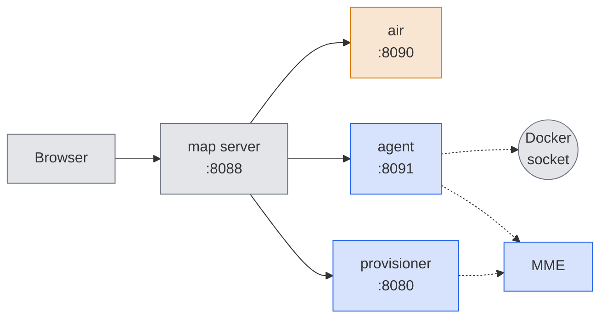

In [part 1](/projects/your-own-telecom-part1) we built a 4G network with a core, two cells and three phones, all running in Docker on a single machine. It worked, but it was very much a network you looked at only through logs and `docker compose` commands, and the phones were stuck in the cell they started in. It was also less stable as on a bad day, one of the three phones simply never attached.

This part covers the next three big updates to the project. First the **world map**, a web page that shows everything running in the network and lets you manage it all from a browser. Then the **stability improvements** that made it possible: a radio that attaches every time, a **handover** between the two cells and **hot-join**, which lets phones and towers be switched off and on while the rest of the network keeps running. Part 1 was also updated to match the current state of the project. As always, all of the sourcecode and the more detailed documentation can be found here: **[github.com/Tonemon/telecom-poc](https://github.com/Tonemon/telecom-poc)**.


## The world map

A real operator doesn't manage its network by only reading container logs. It has a network operations center with big screens showing every tower, how loaded it is and what is going wrong where. I wanted something similar where a single page shows you where every tower and phone is, which phone is connected to which tower, and that even lets you move things around to see how the network responds.

The map runs next to the two-cell network and is started with one additional command `make map` (and `make map-down` to take it down). The map will look like the following when you visit [http://127.0.0.1:8088/](http://127.0.0.1:8088/):

<!-- <video src="/videos/telecom-map-UEs-towers.webm" autoplay loop muted playsinline></video> -->


### How it fits together

The most important design rule of the map is that it is a "live situation overview" with remote control capabilities. It only shows what the network reports, and is able to manage parts of the network through the same interfaces an operator would use in this network. The air stays in charge of the radio world (positions, travel and signal strength) and only through what the core sees/reports we for example know who is attached where. That means closing the page changes nothing in the network, and all actions you can perform through the map can also be done from the CLI. For this every button on the map has a small terminal icon (`>_`) that shows the exact command that is being run.



To explain each part of the flowchart above:

| Part | What it does |
|---|---|
| **Map server** ([`tools/map/`](https://github.com/Tonemon/telecom-poc/tree/main/tools/map)) | A small Go program that serves the world map page (plain HTML and JavaScript built into the binary, nothing is loaded from the internet). Go was chosen as the solution for this as I wanted to learn more about it. |
| **Air** | The shared virtual radio from part 1. For the map to work it now can move a tower, stop a phone, and generate random and realtime activity. |
| **Agent** ([`tools/agent/`](https://github.com/Tonemon/telecom-poc/tree/main/tools/agent)) | One per telecom network. It knows the inventory of this telecom provider (towers, phone models, the operator's name), asks the MME which towers have a working S1 link, and it can run a fixed set of actions in the containers consisting of packet captures, a live ping and a speedtest. |
| **Provisioner** | The operator API from part 1 allowing you to manage subscribers, see which cell a phone is served by, suspend/resume and plan changes. |

The cards on the map show what the operator's core knows, the way a real operations center sees it. A tower's "Link to core" is its S1 link as reported by the MME, and a phone's IP address is the one the SMF gave its session, not something read from inside the phone. A tower whose container is running but which has lost its connection to the core therefore shows "S1 down", just like it would on a real dashboard.

The list of networks the map server knows about is for now a JSON file with only one entry. That list is there for later, when there are multiple operators and the possibility for phones to roam between them.


### Reading the map

The map is a fictional landscape inspired by Battleships with a grid of 1 km squares, rows A to T and columns 1 to 30. Each tower has its own color, and everything else follows from that:

| On the map | Description |
|---|---|
| Shaded areas | A tower's coverage, stronger towards the tower. Unshaded means no signal at all. |
| Dotted lines | The handover lines, where one tower beats the other by the handover margin. Between the two lines is the hysteresis zone, where a phone stays with the tower it already has. |
| Filled dot | A phone with a radio connection right now, in the color of its serving tower. |
| Hollow dot | A phone that is attached, but idle (no radio connection, the next packet wakes it up). |
| Gray dot | A phone without service, or one that is switched off. |
| Orange `!` | The radio is gone (the phone is in a tunnel or a Faraday cage), but the core still thinks the phone is connected. It catches up when its timers run out. |
| Solid / dashed line | From a phone to its serving tower / to another tower it also hears. Brighter means a stronger signal. |
| Flag | A handover happened here, for example "A→B", with the number of pings lost during it if the live ping was on. |

Clicking a tower or a phone opens its information card. Since the whole point of this project is to learn, every telecom term on a card with a dotted underline (PCI, EARFCN, A3, AMBR, ...) explains itself when you hover over it.


### Managing the network

Aside from just visualizing the network, with this map you can also manage parts of the network. A phone's card for example has a "Send somewhere…" button where you can click a destination on the map, pick a speed, and the phone starts driving there. Along the way it hands over from one tower to the other, the filled dot changes color, and a flag appears at the spot where the handover happened.


The speeds are a bit of a time-lapse, as the virtual radio runs at only about a tenth of real time (more on that in the handover chapter later on). The speed slider therefore stops at 1500 km/h, which is the fastest a handover can keep up with, and shows how long the trip will take in real time.

Towers can be moved too, by dragging them. While dragging, a ghost shows the new coverage, and on drop a confirmation lists which phones would gain or lose coverage:


To add some more movement there is also **Random activity**, which lets every phone either stay where it is (about one in three) or drive to a random spot at a random speed, mostly within coverage and sometimes not (for example being in a tunnel). **Realtime activity** does the same, but keeps going. For example, a phone arrives at its destination, waits a little and picks a new destination to move to. There are also a few presets (a highway, a tunnel and a crowded cell), and the whole layout can be downloaded as a map file and uploaded again later.


### Managing individual UEs and cells

Clicking on a phone or tower will give you more insights and utilities:

- **Packet captures.** "Start capture" on a tower records its S1 traffic (the signaling to the core, and the GTP-U tunnels with the phones' data). On a phone, it records what goes in and out of `tun_srsue`. The file can be downloaded from the card and opened in Wireshark.
- **Live ping.** A strip with the last minute of pings (one every 0.2 s) on the phone's card. It is off by default, because a phone that pings all the time never goes idle.
- **Speedtest.** `iperf3` from the phone to the network's gateway (the UPF at `10.45.0.1`), down and up. It measures the radio and the core, not the internet, and you can expect about 1 Mbit/s. That's not the cell being slow, it's the virtual radio.
- **Operator actions.** Suspend, resume and change the plan of the phone's subscriber, the same as `telcoctl` from part 1 of this series.
- **Signal chart.** Each tower's signal strength over the last five minutes, the band the other tower must beat for a handover, and a marker at every handover. Best visible in Video 2 showing the signal strength.


## Stability improvements

With the map in place now there is actual activity in the network, for example phones driving around for minutes at a time, crossing between cells, losing coverage in a tunnel and coming back online. For this to work the network underneath had to be more stable, and getting it there was the biggest part of the work.


### Making the radio reliable

When part 1 was published, the two-cell network had the problem that **only 1 run in 15** had all three phones attached and pinging. Usually one of them (often `ue3` and sometimes `ue1`) never got on the network. It wasn't a slow attach either, the failing phone found its cell, read the system information and sent its random access preambles, but the eNodeB of that cell never logged a single one of them. After ten attempts the phone gave up and started over, forever. The transport looked healthy the whole time, and which phone failed changed from run to run.

To understand what was going on, it helps to know two properties of the virtual radio:

1. **Position in the stream is time.** There are no timestamps on the ZMQ wire. At 11.52 MS/s, the 11 520th sample an eNodeB receives *is* 1 ms after the first one. If a radio ever loses or skips samples, its idea of time is shifted from then on, and nothing can correct it.
2. **Lockstep.** Every receive is a request that waits for its reply, so all eNodeBs and UEs advance together, at the speed of the slowest one. A stall is harmless (everyone just waits), but a slip, where samples are lost, is fatal.

A phone takes its timing from the downlink it receives, and sends its first message on the network (the PRACH preamble) in a fixed subframe. The eNodeB only looks for preambles in that subframe, with about 0.1 ms of tolerance. If an eNodeB's receive clock is shifted against its own transmit clock, every preamble lands outside of that window, which matched the symptoms exactly. The question was what could shift it.

The investigation took two days and some dead ends. First, waiting longer: the `make` targets gave each phone 40 s to attach, and with 3 minutes most "failures" turned out to be slow attaches. That slowness came from a single `PHY` thread at 100 % for about 90 seconds: srsRAN benchmarks every FFT size it needs (`FFTW_MEASURE`) on every start and only caches the result in `$HOME`, which a fresh container never has. A cache folder per eNodeB and UE brought the start from 175 s down to 7 s.

But `ue3` still regularly never attached. On cell A it attached fine, so the phone wasn't the problem, and changing cell B's PCI looked like a lead until a sweep gave PCI 1 ✓, 2 ✗, 3 ✗, 4 ✓, 5 ✓. The failure was simply **random per run**. Lesson learned: with a random failure, compare series of runs, not single runs.

What finally gave it away was measuring where the samples land. A test version of the air recorded the energy of every uplink and downlink in 0.1 ms bins, and **cell B's frame started 0.4 ms off**, not a whole number of subframes. All ten of `ue3`'s preambles landed where cell B never looks.

srsRAN's ZMQ receive code explained why. The eNodeBs had `fail_on_disconnect=true`, copied from the official srsRAN ZeroMQ guide. When a receive gets no samples for 2 seconds, that option bails out *before* the clock advances and throws away the part of the subframe that already arrived. srsenb ignores the error and carries on with its clock behind the stream. On a loaded host the lockstep stood still for more than 2 seconds about once per run, right during the attach.

There was one more twist. A first check with srsRAN's `log_trx_timeout` option showed **zero** timeouts while `ue3` failed, until it turned out that the option itself was broken. It parses the value into one variable and checks another that is always empty. With a one-line patch, each eNodeB logged one or two 2-second timeouts per run, and with `fail_on_disconnect` removed those timeouts only cost time instead of breaking the cell.

After that, **12 of 12** runs from a fully destroyed stack had all three phones attached and pinging, against 1 of 15 before. Both srsRAN bugs are in the latest release of srsRAN_4G, so the plan is to propose the fixes upstream. The full investigation, with every measurement and dead end, is in [`docs/experiments/1-radio-stability.md`](https://github.com/Tonemon/telecom-poc/blob/main/docs/experiments/1-radio-stability.md).


### Handover between cells

In part 1 the phones were stuck in the cell they started in. Each cell had its own GNU Radio broker, which wired one eNodeB to its own phones, so a phone in cell A physically could not hear cell B. For a handover the phone needs to hear both, so both brokers were replaced by one shared **air**. Every phone is now wired to every cell, and a gain per phone/cell pair decides how strong each link is.

That raises the question of where those gains come from, so the air also became a small **world**. It keeps a 2D position in kilometers for every tower and phone:

```text
        ue1   ue2                                          ue3
  A------1-----2-------------------------------------------3-----B
  0 km                                                         10 km
```

For every phone/tower pair the air turns the distance into a gain with a simple log-distance path loss model. Up to 1 km the gain is 1.0 (full signal). Beyond that the power falls with the distance to the power of three, so the amplitude is 0.35 at 2 km, 0.19 at 3 km and 0.09 at 5 km. From 7 km on the gain is 0, as the virtual radio has no noise floor: without a hard edge, a cell would be decodable at any distance. Between 3 and 7 km both cells are heard, and that overlap is where the handover happens.

Both cells use the same frequency (EARFCN 3350), like most real LTE networks do. That makes the neighboring cell not only a candidate for a handover, but also **interference**. Once the neighbor is about 8 dB stronger than the serving cell, the phone can no longer decode its serving cell at all, so the handover has to happen well before that point.


#### S1 instead of X2

In the theory of part 1, eNodeBs coordinate a handover directly with each other over the **X2** interface, and only tell the MME afterwards. srsRAN_4G's eNodeB doesn't implement X2 however, so this network does **S1 handovers**, where everything goes through the MME. The idea is the same, there's just a middleman:

| Step | Message | Between |
|---|---|---|
| 1 | Measurement Report (A3) | phone → source eNodeB (RRC) |
| 2 | `HandoverRequired` | source eNodeB → MME |
| 3 | `HandoverRequest` / `HandoverRequestAcknowledge` | MME ↔ target eNodeB |
| 4 | `HandoverCommand` | MME → source eNodeB, which tells the phone to move |
| 5 | `eNBStatusTransfer` / `MMEStatusTransfer` | source eNodeB → MME → target eNodeB (PDCP sequence numbers) |
| 6 | Random access on the target cell, then `HandoverNotify` | phone → target eNodeB → MME |
| 7 | `Modify Bearer Request` / `Response` (GTPv2) | MME ↔ S-GW: the downlink now goes to the target eNodeB |
| 8 | `UEContextReleaseCommand` / `Complete` | MME ↔ source eNodeB |

There's no new authentication, no new session and no new IP address. Only the radio side and the S1-U tunnel move, which is the path switch from part 1 in action. The UPF stays the anchor of the session, so the phone keeps its IP and a running download or ping just continues.

The decision to hand over is made by the eNodeB, based on the measurements the phone sends. Each eNodeB is configured with the other cell as its neighbor and an **A3 event**, which means "the neighbor has become better than the serving cell by an offset". With these settings, a phone traveling from A to B hands over at around 5.9 km, and one traveling back from B to A at around 4.1 km. That gap between the two points is the hysteresis zone, and it's exactly what the two dotted lines on the world map show.


#### Radio time

One thing that surprised me is how slow the virtual radio is. On the test machine it runs at about **0.1× real time**, so one second of LTE takes about ten seconds of wall time. That isn't a problem for the LTE procedures themselves, as all of their timers run in radio time too: the 640 ms time-to-trigger simply takes about 6 seconds on the clock.

Travel has to follow the same clock, otherwise a phone driving at 100 km/h would cross the handover zone ten times faster than LTE can react. So the air counts the samples that pass through it, and moving phones advance by their speed times the *radio* time that has passed. That's why the speeds look absurd. A phone at 1000 km/h moves at 1000 km/h as far as LTE can tell, while a 6 km trip still takes about three and a half minutes in real time. The real speed limit is the handover itself: above about 1500 km/h a phone crosses from "neighbor slightly better" to "serving cell lost" faster than the handover can complete, and drops the connection instead.


#### Trying it out

Next to the map, travel is also available from the terminal with `make 4g-travel`:

```bash
make 4g-travel                  # where is everyone
make 4g-travel UE=ue2 TO=8      # ue2 drives to x = 8 km (cell B) at 1000 km/h
make 4g-travel WATCH=1          # live view, refreshes every 2 s
make 4g-travel UE=ue3 SHIELD=on # Faraday cage: no coverage at all (SHIELD=off to come back)
```

Which will show:

```output
        1     2                                         3
  A-----------------------------------------------------------B
  0 km                                                    10 km

  UE   position     travel                               gain A/B    serving
  ue1  (1.0, 0.0)   -                                    1.00/0.00   cell A (enb-a)
  ue2  (2.0, 0.0)   -                                    0.35/0.00   cell A (enb-a)
  ue3  (9.0, 0.0)   -                                    0.00/1.00   cell B (enb-b)

  radio runs at 0.10x real time (1 radio-s so far)
```


### Hot-join

Until now there was one problem where when a single phone or tower restarted, it could never line up with the others again, and the only fix was to restart every eNodeB, every phone and the air together. That's not how a real network works where phones are switched on and off all day long. A tower going down for maintenance for example also doesn't restart every phone in the country.

The reason for this problem is the same property that caused the attach problem. As there are no timestamps on the wire, the position in the stream is seen as time. The air was a GNU Radio flowgraph that started all of its streams at sample 0 and assumed every radio did the same. A phone that restarted would start counting from 0 again, while everyone else was millions of samples further.

So the air was rewritten, this time without GNU Radio, as a small numpy **engine** with one clock, which was the air's own clock. Every srsRAN process that connects gets a session that maps its own sample index onto air time. When a new process asks for its first slice of radio, the air notes where in air time that is, and from then on it knows where each of that radio's samples belongs. A few properties make this work in practice:

- **Leaving** is only noticed when the connection closes (or, after a power cut, when ZMQ's own heartbeats go unanswered), never because a radio went quiet. While the air waits for one radio, all the others are quiet too.
- **A booting phone never holds the others up.** Until it transmits, the air does not wait for it.
- **When it first transmits**, the air waits for it to catch up with the downlink it buffered while booting. The other phones' pings slow down for a few seconds, but nothing is lost.

The engine is just logic without any sockets, so it can be unit tested on its own, while a separate layer talks ZMQ (DEALER/ROUTER sockets now, instead of strict REQ/REP) to every eNodeB and UE.


## To be continued

The network is now something you can actually interact with in a better way where phones drive between towers with a real handover, lose coverage in tunnels, get switched off or lose their battery. Towers can also be moved, shut down or lose power, all while you watch what the core notices, and when. The next upgrades are tracked on the [GitHub repo Issues page](https://github.com/Tonemon/telecom-poc/issues). The map was already built with multiple networks in mind, so roaming between operators is going to be on the roadmap, together with 5G alongside the current 4G network.

If you want to run your own telecom in the meantime, everything can be found here: **[github.com/Tonemon/telecom-poc](https://github.com/Tonemon/telecom-poc)**.
